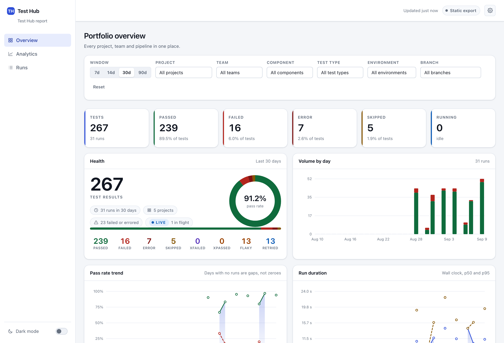
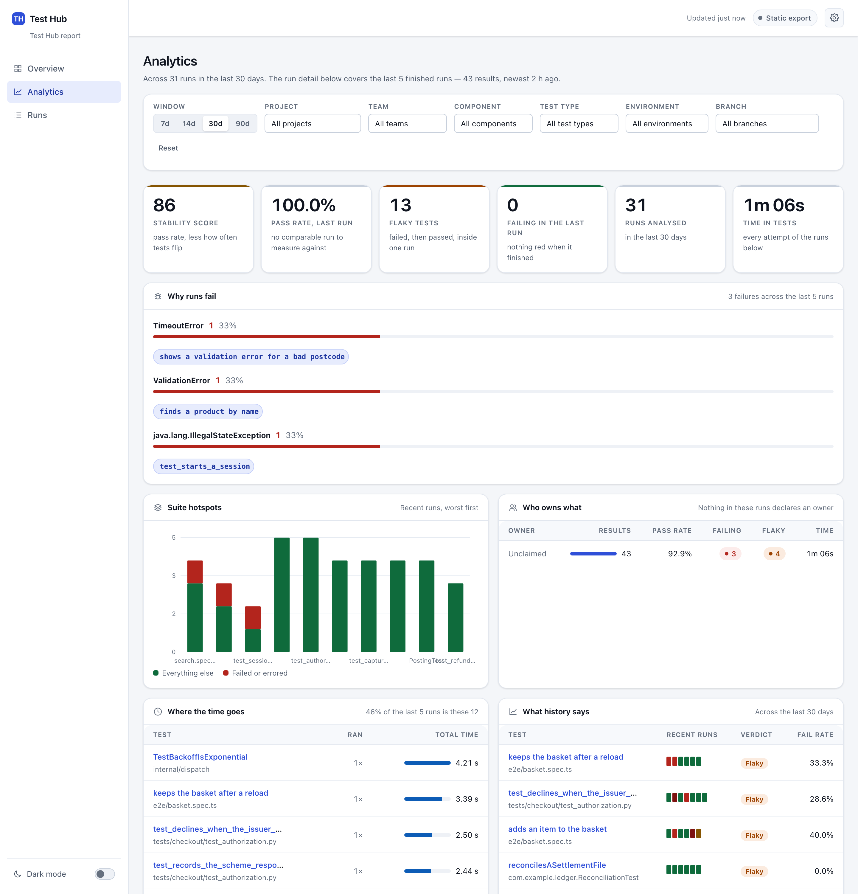
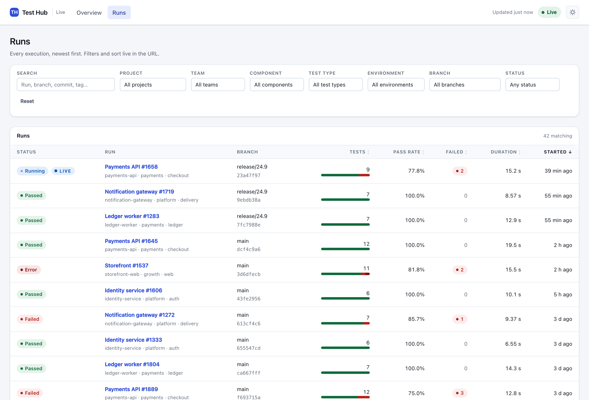
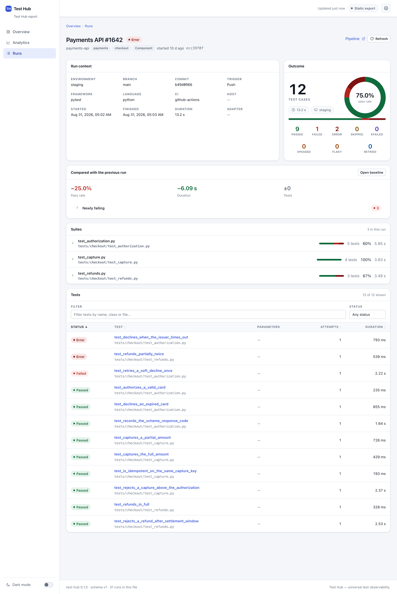
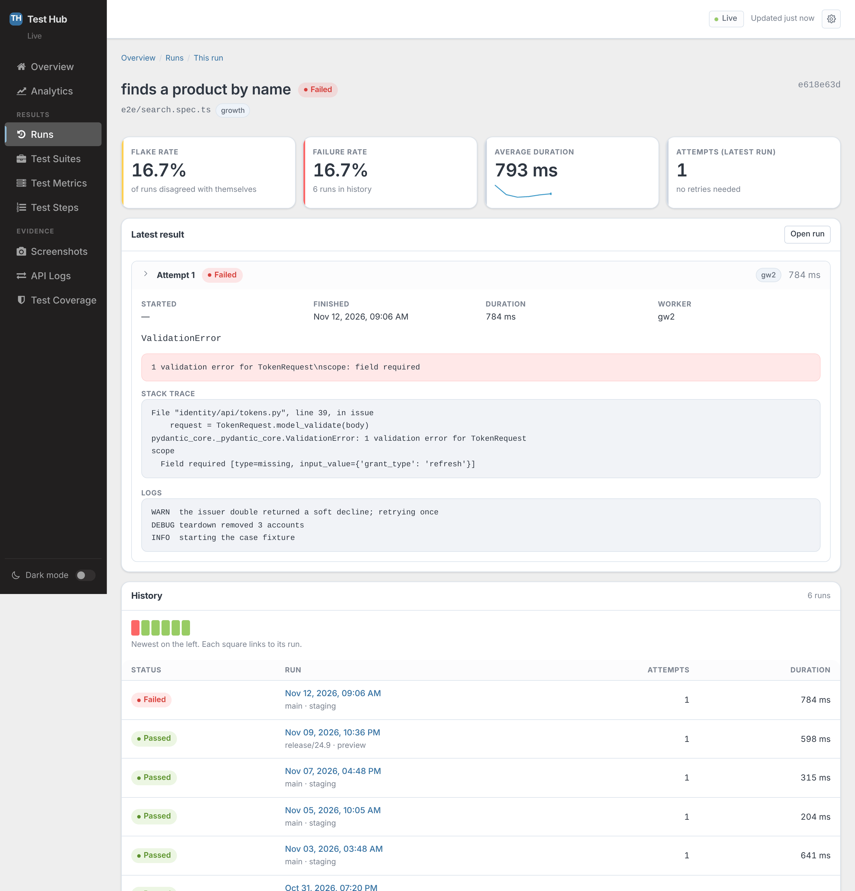

# Test Hub

[](https://github.com/prashanth-sams/test-hub/actions/workflows/ci.yml)
[](https://pypi.org/project/test-hub/)
[](https://pypi.org/project/test-hub/)
[](LICENSE)
[](https://prashanth-sams.github.io/test-hub/)

> **Universal test observability — every team, framework and test run in one place.**

Test Hub collects unit, component, integration, functional and end-to-end test
results from developers, QA engineers, CI pipelines and every team you have,
normalizes them into one canonical model, and shows them in one dashboard.

It does not care what language your tests are written in, what framework ran
them, or what CI system started them. Anything that can send an HTTP request can
publish to it, and `curl` is a first-class client.



## Features

| Feature | Description |
|---|---|
| Language and framework independent | Any tool that can send an HTTP request can publish. JUnit/xUnit XML and Test Hub's own canonical JSON ship in the box; the adapter system is an entry-point plugin API, so new formats install without touching the core. |
| Two products, one dashboard | A live dashboard backed by a small Python service, and a single self-contained HTML file that works with no network. Both are the *same* dashboard code behind two data providers — there is no second renderer to drift. |
| Canonical model | Workspace → project → run → suite → test → attempt, with versioned public schemas that are never the database's shape. Ten normalized statuses, and the framework's original word kept beside every one of them. |
| Retries as first-class attempts | A rerun is a new attempt, never an overwrite. That is what makes flakiness observable at all — and what stops a retried test counting twice. |
| Stable test identity | A UUIDv5 derived from project, suite path, class, name and normalized parameters — never from timestamps or line numbers. Reorder your parameters, move the test down a file, run it on another machine: it is still the same test, and its history follows it. |
| Live updates | Server-Sent Events with heartbeats, `Last-Event-ID` replay and an explicit resync when a client has been away too long. Results appear in the browser within a couple of seconds, without a refresh. |
| Idempotent ingestion | Repost an event, a batch or a whole report — nothing duplicates and no count moves. `(source, event id)` is unique, and `X-Idempotency-Key` covers the batch. |
| Light and dark themes | The dashboard follows your operating system until you flip the dark-mode switch at the foot of the navigation rail, then remembers your choice. Dark is a designed counterpart, not an inversion, and the status language stays identical in both. |
| Run comparison | Every run is measured against the previous *comparable* run — same project, team, component, type, environment and branch — with newly failing, newly passing, still failing, added and removed tests called out. |
| Flaky detection | Within a run (failed then passed on retry) and across runs (disagreeing with its own history). Both formulas are written down in [docs/metrics.md](docs/metrics.md) and implemented exactly once. |
| Executive and engineering altitudes | A portfolio overview that is cheap enough to poll, kept deliberately separate from the run-level drill-down that is allowed to be large — with an analytics page between them that groups failures by the exception that raised them, ranks suites, owners and slow tests, and gives every test a verdict. |
| Secure by default | Loopback-only binding, a refusal to serve an unauthenticated public interface, hashed API tokens, XML parsed with entities disabled, size limits, content-addressed artifacts, a restrictive CSP, and configurable secret redaction over everything it stores. |
| No Node, no CDN | The frontend is hand-written CSS and JavaScript shipped inside the wheel. It loads nothing from the internet, which is what lets the offline export be a single file and the CSP be `default-src 'none'`. |
| Retention you control | Clear runs past a cutoff — `12h`, `90d`, `6m`, an absolute date — along with everything under them and the artifact blobs left unreferenced. From the dashboard's Settings page, which previews exactly what would go before anything does, or with `test-hub prune`. A per-project floor keeps a dormant project from vanishing, and deleting needs an administrator token that is deliberately separate from the one CI publishes with. |
| Runs anywhere | `pip install test-hub`, SQLite, one process. A Dockerfile and a Compose file with a persistent volume are included for when you want it to be somebody else's laptop. |

## A look at the dashboard

The dashboard follows your operating-system theme and remembers a switch, so
every screenshot below comes in both — GitHub shows whichever matches the theme
you are reading in.

**Overview** — the portfolio: totals, trends, project health and what is running right now.

<picture>
  <source media="(prefers-color-scheme: dark)" srcset="docs/images/overview-dark.png">
  
</picture>

**Analytics** — why the suite behaves the way it does: failures grouped by the exception that raised them, suite hotspots, ownership, where the time goes, and a verdict per test.

<picture>
  <source media="(prefers-color-scheme: dark)" srcset="docs/images/analytics-dark.png">
  
</picture>

**Runs** — every run, filtered by project, team, component, type, branch and environment.

<picture>
  <source media="(prefers-color-scheme: dark)" srcset="docs/images/runs-dark.png">
  
</picture>

**Run detail** — the suite tree, the comparison against the previous run, and every test as a searchable row.

<picture>
  <source media="(prefers-color-scheme: dark)" srcset="docs/images/run-detail-dark.png">
  
</picture>

**Test detail** — failure, stack trace, logs, every retry attempt and the test's history across runs.

<picture>
  <source media="(prefers-color-scheme: dark)" srcset="docs/images/test-detail-dark.png">
  
</picture>

## Quick start

Everything below is copy-pasteable and was run exactly as written.

```shell
$ pip install test-hub
```

### See it with data in it

```shell
$ test-hub demo
$ test-hub serve
```

`demo` invents five projects across three teams, two weeks of history, real
failures, genuinely flaky tests and one run that is still going — so the LIVE
indicator has something to show. `serve` opens the dashboard on
<http://127.0.0.1:8000>.

### Import a report you already have

```shell
$ test-hub ingest results.xml \
    --project payments-api \
    --team payments \
    --component checkout \
    --environment staging \
    --type component
```

```
  imported run 0f6c4c1e-4a0f-4a51-9a2c-7a9b1c2d3e4f
  adapter   junit-xml (detected, 90% confident)
  project   payments-api
  5 tests  2 passed  1 failed  1 error  1 skipped  50.0% pass
```

### Publish from CI to a shared server

```shell
$ export TEST_HUB_TOKEN='ths_…'          # created with `test-hub token create`
$ test-hub publish results.xml \
    --url https://test-hub.internal \
    --project payments-api \
    --team payments \
    --type component \
    --token-env TEST_HUB_TOKEN
```

The token is read from the environment, never from a command-line argument — an
argument is visible in `ps` to every user on the machine and lands in shell
history and CI logs.

### Send one HTML file to somebody who has no server

```shell
$ test-hub export --input ./results --output test-hub-report.html --project payments-api
```

One file. Open it on a plane. It carries its own CSS, its own JavaScript and its
own data, and loads nothing from the network.

## Publishing without Python

Test Hub's API is the product; the Python SDK is a convenience. This is a
complete publisher:

```shell
curl -X POST https://test-hub.internal/api/v1/imports \
  -H "Authorization: Bearer $TEST_HUB_TOKEN" \
  -F "file=@target/surefire-reports/TEST-com.example.LedgerTest.xml" \
  -F "project=ledger-worker" \
  -F "team=payments" \
  -F "type=integration" \
  -F "environment=staging" \
  -F "branch=$GIT_BRANCH" \
  -F "commit=$GIT_COMMIT"
```

And this is a live publisher, streaming results as the suite runs:

```shell
RUN=$(curl -sX POST "$HUB/api/v1/runs" -H 'content-type: application/json' \
  -d '{"project_key":"storefront-web","test_type":"e2e"}' | jq -r .id)

curl -X POST "$HUB/api/v1/runs/$RUN/events" \
  -H 'content-type: application/json' -H "X-Idempotency-Key: batch-1" \
  -d @events.json

curl -X POST "$HUB/api/v1/runs/$RUN/finish" -H 'content-type: application/json' -d '{}'
```

Every one of those calls is safe to retry. See [docs/api.md](docs/api.md) for the
full reference, and [docs/ci/github-actions.md](docs/ci/github-actions.md) and
[docs/ci/jenkins.md](docs/ci/jenkins.md) for worked pipeline examples.

## The two modes

|  | Snapshot | Live |
|---|---|---|
| Command | `test-hub export` | `test-hub serve` |
| Output | one self-contained `.html` | a service on a port |
| Needs a server to read | no | yes |
| Works offline | yes | the dashboard is local |
| Updates while you watch | no | yes, over SSE |
| Data provider | `SnapshotDataProvider` | `LiveDataProvider` |
| Dashboard code | **identical** | **identical** |

That last row is the architecture. One dashboard, two data providers — see
[ADR-0001](docs/adr/0001-architecture.md).

## How the numbers are calculated

Every definition is written down in [docs/metrics.md](docs/metrics.md) and
implemented exactly once, in `test_hub.domain.metrics`. The short version:

- **Pass rate** — `(passed + xfailed) / executed`, where `executed` excludes
  skipped and cancelled tests. Each test counts once, through its *last* attempt.
  A run that only skipped has a pass rate of "—", not 0%.
- **Failure rate** — `(failed + error + xpassed) / executed`.
- **Duration** — wall clock when the run reported both ends, because with
  parallel workers the sum of test durations is not a duration anyone means.
- **Flaky** — within a run: the test both failed and passed across its attempts.
  Across runs: it disagreed with its own recent history.

Counts are always folded from the stored attempts and never taken from a
publisher's own totals, which drift the moment anything is retried or a shard
fails to upload.

## Supported formats

```shell
$ test-hub formats
```

| Adapter | Format | Detection |
|---|---|---|
| `junit-xml` | JUnit / xUnit XML — pytest, Surefire, Gradle, Jest, Playwright, and the rest of the family. Handles nested suites, `system-out`/`system-err`, properties, and Surefire's `rerunFailure`/`flakyFailure` retry elements. | `<testsuites>` or `<testsuite>` root |
| `testhub-json` | Test Hub canonical JSON — a friendly report shape, or a raw event stream. | `"kind": "test-hub-report"` / `"test-hub-events"` |

Test Hub deliberately does **not** advertise support for "any JSON" or "any XML":
an adapter that guesses produces silently wrong numbers. Unknown input returns a
415 listing every installed adapter.

Adding a format is an entry-point plugin — the two built-in adapters are
registered exactly the same way, so there is no privileged internal path. See
the [adapter-authoring guide](docs/adapters.md).

## Security

Test Hub ingests untrusted text — test output routinely contains credentials,
HTML and things that look like markup — and renders it in a browser. The defaults
assume that:

- Binds `127.0.0.1`. Binding anywhere else **requires** authentication, or an
  explicit `--insecure-no-auth` that warns on every start. There is no silent
  path to an open Test Hub on a network.
- API tokens are stored as PBKDF2 hashes. The plaintext exists once, in the
  output of `test-hub token create`.
- XML is parsed with `defusedxml`: DTDs and external entities are refused, not
  expanded. Billion-laughs and XXE fixtures are in the test suite.
- Upload size limits enforced while reading, not after. A gzipped report is
  decompressed transparently with a separate ceiling on what it may expand to,
  so a decompression bomb is refused mid-expansion.
- Content-addressed artifact storage, so a publisher-supplied filename never
  reaches the filesystem at all.
- A restrictive `Content-Security-Policy`, and no inline scripts or styles for it
  to have to allow.
- Snapshot JSON is embedded so that a test named `</script>` renders as text — verified by test.
- Configurable secret redaction over logs and stored failure output.

Full detail and the threat model are in [SECURITY.md](SECURITY.md) and
[docs/security.md](docs/security.md).

## Documentation

| | |
|---|---|
| [Architecture](docs/architecture.md) | How it fits together, and why |
| [ADR-0001](docs/adr/0001-architecture.md) | The decisions, the alternatives, and the known limits |
| [ADR-0002](docs/adr/0002-data-retention.md) | Retention: what a prune deletes, and what protects it |
| [Canonical schemas](docs/schemas/README.md) | The versioned wire contract |
| [Event contract](docs/events.md) | The CloudEvents envelope and all eight event types |
| [Metrics](docs/metrics.md) | Every formula, exactly |
| [REST API](docs/api.md) | Endpoints with `curl` examples |
| [Adapter guide](docs/adapters.md) | Writing and publishing a format plugin |
| [Security](docs/security.md) | Threat model and hardening |
| [Deployment](docs/deployment.md) | Docker, Compose, reverse proxies, backups |
| [Scaling](docs/scaling.md) | Where PostgreSQL, S3 and a queue would fit |
| [Contributing](CONTRIBUTING.md) | Setup, layering rules, release process |

## Not in the first release

Deliberately, and with the extension points left in place: test authoring or
manual test management, test execution and orchestration, AI failure analysis,
SSO/SAML/SCIM, full multi-tenancy, Kubernetes manifests, licence enforcement, and
notifications or issue-tracker integrations.

## Licence

[Apache-2.0](LICENSE).
