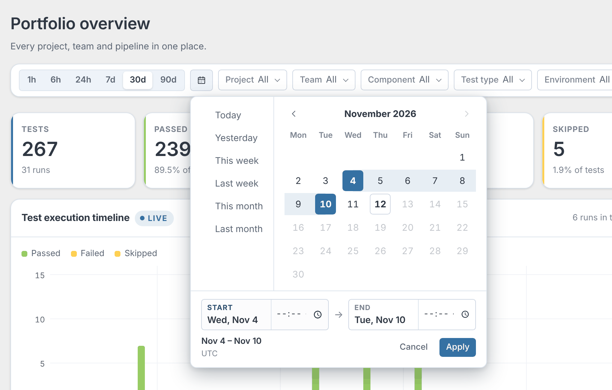
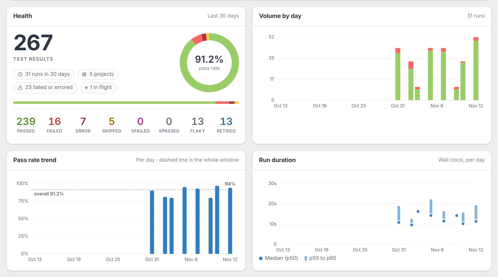
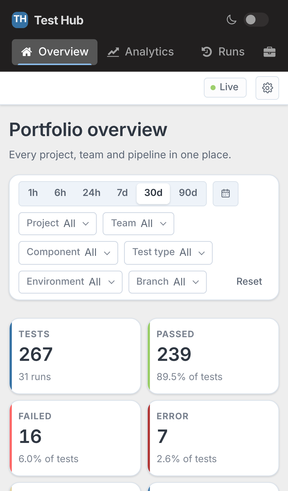

# Test Hub

[](https://github.com/prashanth-sams/test-hub/actions/workflows/ci.yml)
[](https://pypi.org/project/test-hub/)
[](https://pypi.org/project/test-hub/)
[](LICENSE)
[](https://prashanth-sams.github.io/test-hub/)

**One live dashboard for every test run — any team, any framework, any CI.**

Test Hub collects unit, integration and end-to-end results from developers, QA
and CI pipelines, normalizes them into one model, and shows them as they happen.
If it can send an HTTP request, it can publish — `curl` included.

<picture>
  <source media="(prefers-color-scheme: dark)" srcset="docs/images/overview-dark.png">
  
</picture>

## Quick start

```shell
pip install test-hub
test-hub demo      # five projects, two weeks of history, one run still going
test-hub serve     # → http://127.0.0.1:8000
```

One process and SQLite — nothing else to install.

## Why Test Hub

- **Any framework, any CI.** JUnit/xUnit XML and Test Hub JSON out of the box; new formats are plugins.
- **Live.** Results stream in over Server-Sent Events, and a run lands on the timeline the moment it starts.
- **One time window, every page.** 1 hour to 90 days, or any range on a calendar — kept in the URL, so a link shares it.
- **Flakiness you can see.** A retry is a new attempt, never an overwrite; flaky tests are caught within a run and across runs.
- **Every run compared.** Against the previous comparable run: newly failing, newly passing, still failing.
- **Stable test identity.** A test keeps its history when it is reordered, moved or run on another machine.
- **Safe to retry.** Repost an event, a batch or a whole report — nothing duplicates, no count moves.
- **Secure by default.** Loopback-only bind, hashed tokens, hardened XML parsing, a strict CSP.
- **Runs anywhere.** SQLite by default, PostgreSQL with one variable, Docker Compose included.
- **No Node, no CDN.** The dashboard ships inside the wheel and works air-gapped.

## A tour

Every screenshot follows the theme you are reading in — the dashboard does too,
until you flip the switch in its rail.

<table>
  <tr>
    <td width="50%"><b>Pick any window</b> — presets from 1 hour to 90 days, or a range on one calendar: quick ranges, first day then last, optional times.</td>
    <td width="50%"><b>Read the trend</b> — pass rate per day against the window's overall rate, and run duration as p50 to p95 with the median.</td>
  </tr>
  <tr>
    <td>
      <picture>
        <source media="(prefers-color-scheme: dark)" srcset="docs/images/range-picker-dark.png">
        
      </picture>
    </td>
    <td>
      <picture>
        <source media="(prefers-color-scheme: dark)" srcset="docs/images/trends-dark.png">
        
      </picture>
    </td>
  </tr>
</table>

**Analytics** — failures grouped by the exception that raised them, suite hotspots, owners, where the time goes, and a verdict for every test.

<picture>
  <source media="(prefers-color-scheme: dark)" srcset="docs/images/analytics-dark.png">
  
</picture>

**Run detail** — context, outcome, the comparison with the previous run, the suite tree and every test.

<picture>
  <source media="(prefers-color-scheme: dark)" srcset="docs/images/run-detail-dark.png">
  
</picture>

**Test detail** — the failure with its stack trace and logs, every attempt, and the test's history across runs.

<picture>
  <source media="(prefers-color-scheme: dark)" srcset="docs/images/test-detail-dark.png">
  
</picture>

<table>
  <tr>
    <td width="72%"><b>Runs</b> — every execution, newest first; filters and sort live in the URL.</td>
    <td><b>On a phone</b> — the same dashboard, re-laid out.</td>
  </tr>
  <tr>
    <td>
      <picture>
        <source media="(prefers-color-scheme: dark)" srcset="docs/images/runs-dark.png">
        
      </picture>
    </td>
    <td></td>
  </tr>
</table>

## Publish results

**From a report file** — any JUnit/xUnit XML (pytest, Surefire, Gradle, Jest, Playwright…) or Test Hub JSON:

```shell
test-hub ingest results.xml --project payments-api --team payments --type component
```

```
  imported run 776525a3-e310-420c-9b5b-eb0e8be86592
  adapter   junit-xml (detected, 90% confident)
  project   payments-api
  5 tests  2 passed  1 failed  1 error  1 skipped  50.0% pass
```

**From CI, to a shared server** — the token is read from the environment, never from the command line, where `ps`, shell history and CI logs would see it:

```shell
export TEST_HUB_TOKEN='ths_…'          # from `test-hub token create`
test-hub publish results.xml --url https://test-hub.internal \
  --project payments-api --team payments --type component --token-env TEST_HUB_TOKEN
```

**Without Python** — the API is the product:

```shell
curl -X POST https://test-hub.internal/api/v1/imports \
  -H "Authorization: Bearer $TEST_HUB_TOKEN" \
  -F "file=@target/surefire-reports/TEST-com.example.LedgerTest.xml" \
  -F "project=ledger-worker" -F "type=integration" -F "branch=$GIT_BRANCH"
```

**Live, while the suite runs** — open a run, stream its events, finish it. Every call is safe to retry:

```shell
RUN=$(curl -sX POST "$HUB/api/v1/runs" -H 'content-type: application/json' \
  -d '{"project_key":"storefront-web","test_type":"e2e"}' | jq -r .id)
curl -X POST "$HUB/api/v1/runs/$RUN/events" -H 'content-type: application/json' \
  -H "X-Idempotency-Key: batch-1" -d @events.json
curl -X POST "$HUB/api/v1/runs/$RUN/finish" -H 'content-type: application/json' -d '{}'
```

Worked pipelines: [GitHub Actions](docs/ci/github-actions.md) · [Jenkins](docs/ci/jenkins.md). Every endpoint: [REST API](docs/api.md).

## Run it for a team

| | |
|---|---|
| **Database** | SQLite by default — the faster choice for one Test Hub. For PostgreSQL, `pip install "test-hub[postgres]"`, set `TEST_HUB_DATABASE_URL=postgresql://…` and confirm with `test-hub db check`. See [choosing a database](docs/deployment.md#choosing-a-database). |
| **Docker** | `docker compose up -d` — add `-f docker-compose.postgres.yml` for PostgreSQL. See [deployment](docs/deployment.md). |
| **Tokens** | `test-hub token create` prints a token once, with the hash to configure on the server. |
| **Retention** | `test-hub prune --older-than 90d --dry-run`, or the Settings page, which previews exactly what would go before anything does. |
| **Scale** | Where the ceilings are, measured: [scaling](docs/scaling.md). |

## How the numbers are calculated

- **Pass rate** = (passed + xfailed) ÷ executed. Skipped and cancelled tests are not executed; each test counts once, by its last attempt.
- **Failure rate** = (failed + error + xpassed) ÷ executed.
- **Duration** = wall clock — with parallel workers, the sum of test durations is not a duration anyone means.
- **Flaky** = failed and passed within one run, or disagreed with its own recent history.

Counts are always folded from the stored attempts, never taken from a publisher's own totals. Every formula is in [docs/metrics.md](docs/metrics.md).

## Supported formats

| Adapter | Format |
|---|---|
| `junit-xml` | JUnit / xUnit XML — pytest, Surefire, Gradle, Jest, Playwright and the rest of the family, retries included. |
| `testhub-json` | Test Hub canonical JSON — a report, or a raw event stream. |

Input that matches no adapter is refused with a list of what is installed — never guessed at. New formats are entry-point plugins; see the [adapter guide](docs/adapters.md).

## Security

- Binds `127.0.0.1`. Any other interface requires authentication, or an explicit `--insecure-no-auth` that warns on every start.
- API tokens are stored as PBKDF2 hashes; the plaintext is shown once.
- XML is parsed with DTDs and external entities refused, and uploads are size-capped while they are read.
- Artifacts are content-addressed, and every value reaches the page as text under a `default-src 'none'` CSP.
- Secret redaction runs over everything stored.

Threat model and hardening: [SECURITY.md](SECURITY.md) · [docs/security.md](docs/security.md).

## Documentation

| | |
|---|---|
| [Documentation site](https://prashanth-sams.github.io/test-hub/) | Guides, the dashboard tour and the CLI reference |
| [Architecture](docs/architecture.md) | How it fits together, and why |
| [REST API](docs/api.md) | Every endpoint, with `curl` |
| [Canonical schemas](docs/schemas/README.md) | The versioned wire contract |
| [Event contract](docs/events.md) | The CloudEvents envelope and every event type |
| [Metrics](docs/metrics.md) | Every formula, exactly |
| [Adapter guide](docs/adapters.md) | Writing and publishing a format plugin |
| [Deployment](docs/deployment.md) | Docker, PostgreSQL, reverse proxies, backups |
| [Scaling](docs/scaling.md) | Where the ceilings are, and what lifts them |
| [Security](docs/security.md) | Threat model and hardening |
| Decisions | [Architecture](docs/adr/0001-architecture.md) · [Retention](docs/adr/0002-data-retention.md) · [No offline export](docs/adr/0003-drop-the-offline-export.md) · [PostgreSQL](docs/adr/0004-postgresql.md) |
| [Contributing](CONTRIBUTING.md) | Setup, layering rules, releases |

## Not in scope yet

Test authoring, test execution, AI failure analysis, SSO/SAML, multi-tenancy,
Kubernetes manifests and notifications — deliberately, with the extension points
left in place.

## Licence

[Apache-2.0](LICENSE).
